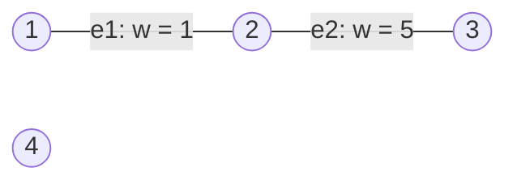
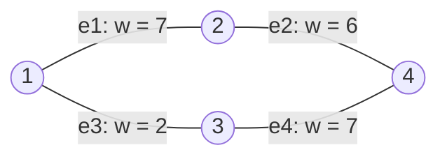
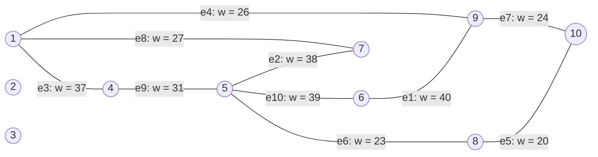

# Graph diagrams for tests 01–05

All edges are undirected. Edge labels preserve the input edge number and weight.

## `test01.uwg`

- Vertices: `4`
- Edges: `2`
- M: `5`

## `test02.uwg`

- Vertices: `4`
- Edges: `4`
- M: `10`

## `test03.uwg`

- Vertices: `10`
- Edges: `10`
- M: `50`

